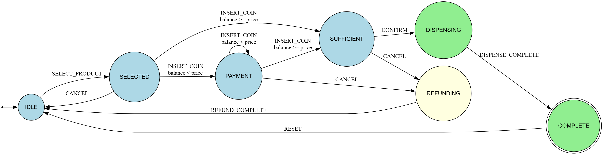

# Smart Vending Machine Simulator

A C++ based vending machine simulator implementing Finite State Machine (FSM) concepts from Theory of Computation.

## Overview

The project simulates a vending machine that allows users to select products, insert coins, make payments, receive change, and view transaction history.

The system uses a state-based architecture to control the vending process.

## Features

- Product selection and inventory management
- Multiple accepted coin denominations
- Automatic balance calculation
- Change calculation
- Payment-aware FSM transitions
- Transaction history
- File-based transaction storage
- Input validation
- Cancellation and refund logic

## Technologies Used

- C++
- Object-Oriented Programming
- Finite State Machine
- File Handling
- Graphviz

## FSM States

1. IDLE
2. SELECTED
3. PAYMENT
4. SUFFICIENT
5. DISPENSING
6. REFUNDING
7. COMPLETE

## State Transition Diagram



## Project Structure

```text
VendingMachine/
├── main.cpp
├── Automaton.h
├── Automaton.cpp
├── Product.h
├── Product.cpp
├── PaymentManager.h
├── PaymentManager.cpp
├── TransactionManager.h
├── TransactionManager.cpp
├── vending_machine.dot
├── docs/
│   └── vending_machine_fsm.png
└── README.md
```

## Accepted Coins

- Rs. 5
- Rs. 10
- Rs. 20
- Rs. 50

## Available Products

| Product | Price |
|---|---:|
| Chips | Rs. 20 |
| Chocolate | Rs. 30 |
| Cold Drink | Rs. 40 |
| Nachos | Rs. 25 |

## Compilation

```bash
g++ -Wall main.cpp Automaton.cpp Product.cpp PaymentManager.cpp TransactionManager.cpp -o vending.exe
```

## Future Improvements

- Persistent transaction history across sessions
- Improved cancellation and refund testing
- Graphical user interface
- Advanced FSM transition testing

## Learning Outcomes

- Understanding finite state machines
- Implementing state transitions in C++
- Applying object-oriented programming
- Managing inventory and payments
- Working with file handling
